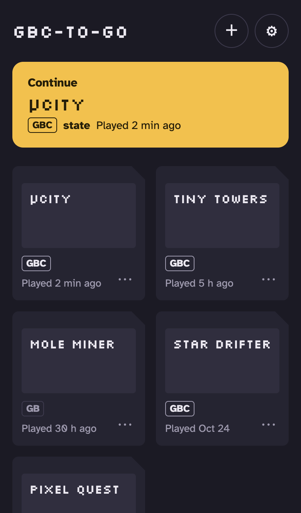
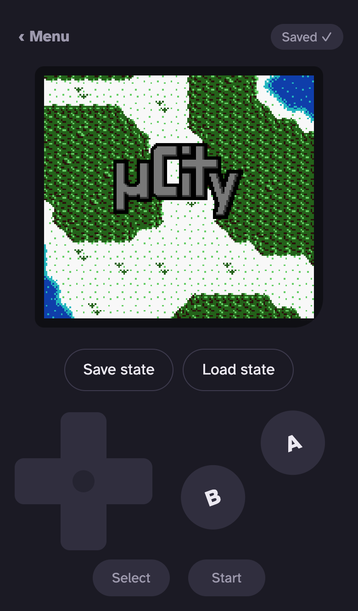
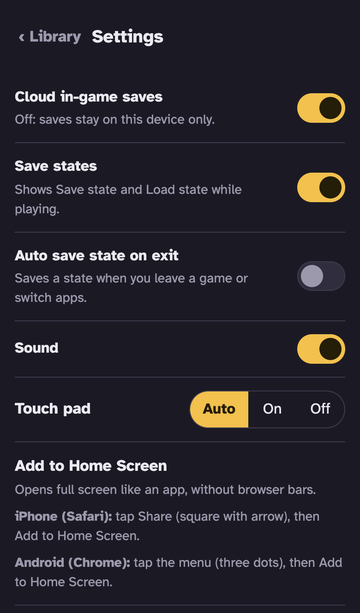
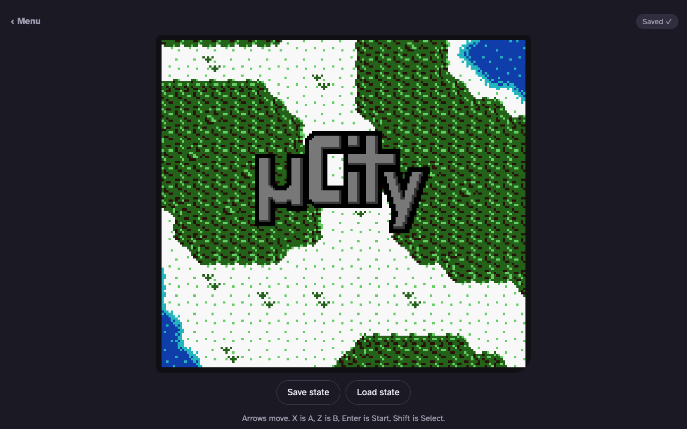
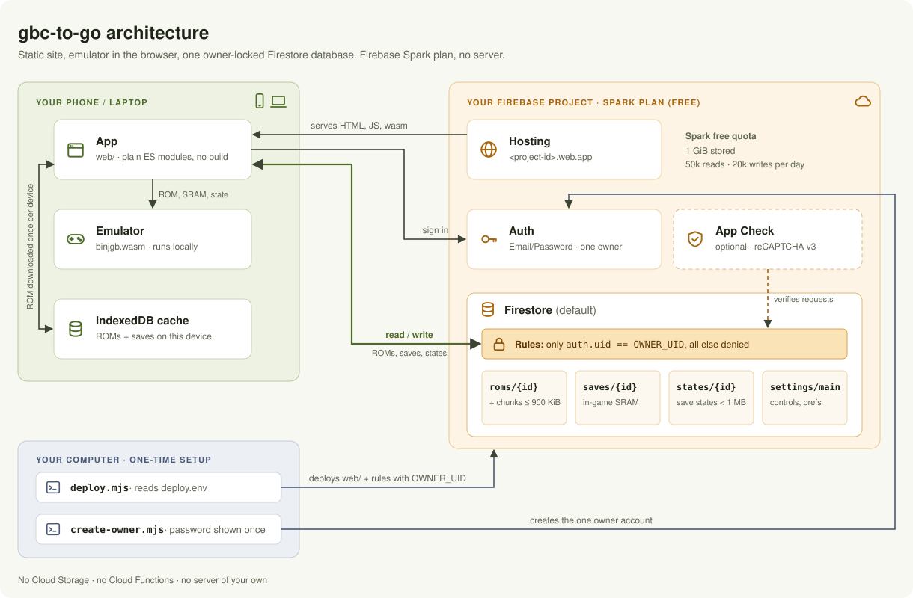

# gbc-to-go

Your own Game Boy / Game Boy Color player on the web, on your own free Firebase project.

- Upload your own `.gb` / `.gbc` ROMs in the browser.
- Play on your phone (touch pad) or laptop (keyboard).
- In-game saves and save states sync to the cloud, so they follow you between devices.
- One owner per site. Nobody else gets in.
- Runs on the free Firebase Spark plan. No credit card.

<p align="center">
  
  
  
</p>
<p align="center">
  
</p>
<p align="center"><sub>Game shown: <a href="https://github.com/AntonioND/ucity">µCity</a> by Antonio Niño Díaz, open-source homebrew (code GPLv3+, graphics CC BY-SA 4.0). Other library titles are placeholders.</sub></p>

> **Security, read this first**
> - Setup creates exactly **one** owner account with a **random password that is shown once**. Put it in your password manager right away.
> - **Never commit** `deploy.env` or `web/firebase-config.js`. They are in `.gitignore`; keep it that way.
> - The database rules only let your owner account in. Any other account (even one someone creates on your project) gets nothing.

## Legal note

gbc-to-go is a player only. It ships with no games. Use only ROMs you legally own and dumped yourself from your own cartridges. This project does not host, link to, or help find ROMs, and it has no sharing feature. Your files are stored only in your private Firebase project, which only your owner account can read (see [rules/firestore.rules](rules/firestore.rules)). You are responsible for complying with the copyright law that applies to you.

- Do not commit `.gb`, `.gbc` or `.sav` files to the repo.
- Not affiliated with, endorsed by, or sponsored by Nintendo. Game Boy, Game Boy Color and Pokémon are trademarks of their respective owners; they are used here only to describe compatibility.

## Why it is free

- Firebase Cloud Storage now needs the paid Blaze plan ([Firebase FAQ](https://firebase.google.com/docs/storage/faqs-storage-changes-announced-sept-2024)).
- So ROMs are stored in **Firestore** instead, split into chunks of up to 900 KiB (a Firestore document can be at most 1 MiB).
- Each device caches the ROM after the first download, so chunks are read once per device.
- Spark Firestore free quota: 1 GiB stored, 50,000 reads/day, 20,000 writes/day. That is plenty for one player.

## How it works



- The site is static files on Hosting. The emulator runs fully in your browser.
- ROMs, saves, states and settings live in Firestore. The rules let only your owner UID read or write.
- Each device caches ROMs and saves in IndexedDB, so a ROM is downloaded once per device.
- No Cloud Storage, no Cloud Functions, no server of your own.

## Setup

**Easiest way:** open this folder with a coding agent (e.g. Claude Code) and say "set this up for me". It follows [AGENTS.md](AGENTS.md) and tells you when to click something.

You need: [Node.js](https://nodejs.org/) 20 or newer, a Google account, and a copy of this repo (fork or clone). Mac, Linux and Windows all work (deploy is plain Node).

```sh
git clone https://github.com/<you>/gbc-to-go.git
cd gbc-to-go
git checkout $(git describe --tags --abbrev=0)   # latest release
npm install
npx -y firebase-tools@15.34.2 login
```

- The `git checkout` line puts you on the latest tagged release instead of in-progress work on `main`. See [CHANGELOG.md](CHANGELOG.md) for what changed. To update later, see [Updating your instance](#updating-your-instance).
- `npm install` may print warnings; they are harmless.
- On Windows, use `copy` instead of `cp` below, with backslashes (e.g. `copy deploy.env.example deploy.env`).

### 1. Create a Firebase project (Spark)

- Go to the [Firebase console](https://console.firebase.google.com/) and click **Create a project**.
- Google Analytics is not needed.
- New projects start on the free **Spark** plan. Do not upgrade.
- Note the **project ID**, then:

```sh
cp deploy.env.example deploy.env
# Windows: copy deploy.env.example deploy.env
```

- In `deploy.env`, set `PROJECT=` to your project ID. Leave `OWNER_UID=` empty; step 5 fills it.

### 2. Add a web app and copy its config

- Project overview > **Add app** > Web (`</>`). Any nickname. Hosting setup in that dialog is not needed.
- Copy the `firebaseConfig` values it shows.

```sh
cp web/firebase-config.example.js web/firebase-config.js
# Windows: copy web\firebase-config.example.js web\firebase-config.js
```

- Paste `apiKey`, `authDomain`, `projectId` and `appId` into `firebaseConfig` in `web/firebase-config.js`. The other values are not needed. Leave `appCheckSiteKey` empty for now.

### 3. Create the Firestore database

- **Build > Firestore Database > Create database**.
- Keep the database ID `(default)`. The free tier applies to the `(default)` database.
- Pick a region near you. You cannot change it later.
- Start in **production mode**. The database denies everything until step 6 deploys your own rules.
- If the console says the Cloud Firestore API is disabled, click **Enable** on the page it links to, wait a minute, and try again.

### 4. Enable Email/Password sign-in

- Open `https://console.firebase.google.com/project/<project-id>/authentication`.
- **Get started > Sign-in method > Email/Password > Enable > Save**. A new project has no Auth set up until you click **Get started**.
- Leave "Email link (passwordless sign-in)" off.

### 5. Create your owner account

```sh
node scripts/create-owner.mjs you@example.com
```

- It prints your email and a random password **once**. Store it in your password manager now. It is not saved anywhere.
- It writes your account's ID into `deploy.env` as `OWNER_UID=...`.
- Lost the password? Firebase console > **Authentication > Users** > **⋮** > **Reset password** (see [AGENTS.md](AGENTS.md)).

### 6. Deploy

```sh
npm run deploy
```

- Deploys the site and the owner-only database rules.
- Your site is at `https://<project-id>.web.app/` (the project's default Hosting site; no extra setup). Sign in with the email and password from step 5.
- `npm run deploy -- --dry-run` checks your config and prints what it would deploy, without deploying.
- If deploy says the site is not found, run `npx -y firebase-tools@15.34.2 hosting:sites:create <project-id> --project <project-id>` and deploy again.

### 7. Optional: App Check

App Check blocks requests that do not come from your site. Recommended once everything works.

- Create a reCAPTCHA v3 site key in the [reCAPTCHA admin console](https://www.google.com/recaptcha/admin) and add your domain (`<project-id>.web.app`).
- In Firebase: **Build > App Check > Apps**, register your web app with **reCAPTCHA**, and paste the secret key.
- Put the site key into `appCheckSiteKey` in `web/firebase-config.js`, then `npm run deploy`.
- Check the site still works, then in **App Check > APIs > Cloud Firestore** click **Enforce**.

### 8. Optional: turn off new sign-ups

Other accounts already get nothing, but you can stop them being created at all.

- Do this last, after everything works (the rules check in [AGENTS.md](AGENTS.md) needs sign-ups on).
- **Authentication > Settings > User actions**: untick **Enable create (sign-up)** and save.
- To make a new owner account later, tick it again first.

## Updating your instance

Run these from your clone. Your `deploy.env` and `web/firebase-config.js` stay as they are (they are gitignored).

```sh
git fetch --tags origin
git checkout $(git describe --tags --abbrev=0 origin/main)   # newest release
npm install
npm run deploy
```

- Check [CHANGELOG.md](CHANGELOG.md) first for anything that needs a manual step.
- Your ROMs, saves and settings live in Firestore and are not touched.
- Cloned from your own fork? Its tags may lag behind. Add this repo once with `git remote add upstream https://github.com/moeritze/gbc-to-go.git`, then use `upstream` instead of `origin` in the first two lines.
- Want to go back? Check out the older tag, then `npm install` and `npm run deploy` again.

## Your ROMs

- Open your site, sign in, tap **＋**, pick a `.gb` or `.gbc` file.
- ROMs live in your Firestore database, never in the repo.
- Uploading the same ROM twice does nothing (it is recognised by its SHA-1).
- Delete a game with **⋯** on its tile. This also deletes its save and save state.

## Controls

| Game Boy | Keyboard |
| --- | --- |
| D-pad | Arrow keys |
| A | X |
| B | Z |
| Start | Enter |
| Select | Shift or Backspace |

On a phone, an on-screen touch pad appears. Settings let you force it on or off.

## Settings

- **Cloud in-game saves** (on): off keeps saves on this device only.
- **Save states** (on): off hides the Save state / Load state buttons.
- **Auto save state on exit** (off): saves a state when you leave a game or switch tabs.
- **Touch pad** (auto / on / off), **Sound** (on).

## Clock games

Some games (for example Pokémon Gold, Silver and Crystal) have a real-time clock in the cartridge.

- Your in-game progress is kept by normal in-game saves, as usual.
- The clock is **not** part of the in-game save file. It resets when you start the game again.
- Save states do keep the clock. Use **Save state** / **Load state** (or **Auto save state on exit**) if the clock matters to you.

## Limits

- ROMs up to 8 MiB (the largest Game Boy size).
- One save state slot per game.
- Save states are stored in the cloud only and need a connection; in-game saves also keep a copy on the device.
- Needs a network connection to sign in and to download a ROM the first time.
- Free quota: 1 GiB stored, 50,000 reads/day, 20,000 writes/day (Spark Firestore).
- One owner per site. Want a second player? They deploy their own copy.

## Ideas welcome

Not built yet, and good first contributions:

- Real-time clock in in-game saves (clock games)
- Link cable, netplay
- Cheats, rewind, fast-forward
- Shaders and screen filters
- Offline play (service worker)
- Box art or other metadata
- Other systems (GBA, NES)

Multi-user sites, sharing and public libraries are out of scope on purpose. See [CONTRIBUTING.md](CONTRIBUTING.md).

## License

MIT, see [LICENSE](LICENSE).

- The bundled emulator core [binjgb](https://github.com/binji/binjgb) (MIT, Ben Smith) keeps its own license in `web/vendor/LICENSE`, served at `/vendor/LICENSE`.
- `web/emulator.js` is adapted from binjgb `docs/simple.js` (MIT, Ben Smith).
- Fonts are loaded from Google Fonts (SIL OFL 1.1): Atkinson Hyperlegible and Silkscreen. Google sees visitors' IP addresses; self-host them if that matters to you.
